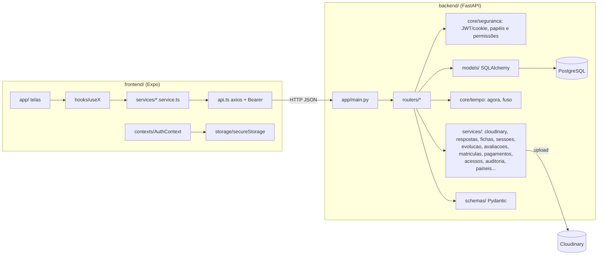
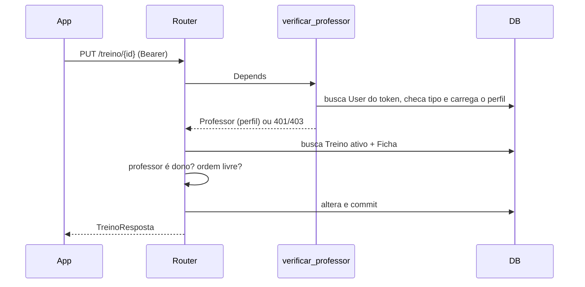
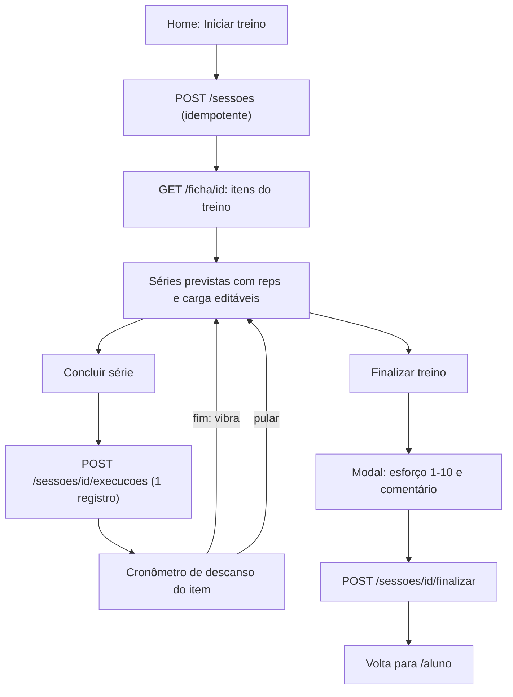
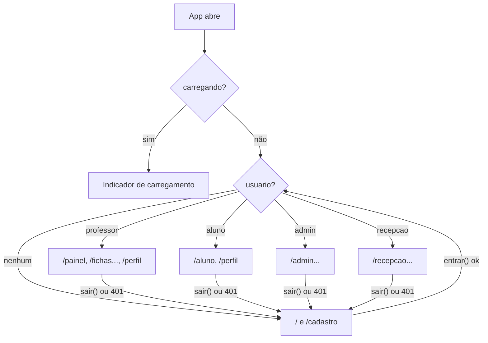

# Arquitetura

Voltar: [[Home]] · Relacionados: [[Database]] · [[API]] · [[Decisions]] · [[Technical-Debt]] · [[Contrato-Gestao]]

## Stack real

| Camada | Tecnologia | Versão (fixada) |
|---|---|---|
| Linguagem backend | Python | 3.13 |
| Framework HTTP | FastAPI | 0.141.1 |
| ORM | SQLAlchemy (síncrono, `Mapped`/`mapped_column`) | 2.0.x |
| Validação | Pydantic | 2.13 |
| Migrações | Alembic | — ver `backend/requirements.txt` |
| Banco | PostgreSQL via psycopg2 | — |
| Auth | JWT HS256 (`python-jose`), bcrypt (`pwdlib`), `HTTPBearer` (mobile) e cookie `HttpOnly` `fitflow_sessao` (web, ADR-034) | — |
| Mídia | Cloudinary (imagem/vídeo de exercício e foto de perfil, ADR-012); fotos de perfil locais antigas ainda são servidas do disco (`uploads/perfis`) | — |
| Mobile | Expo SDK 57, React Native 0.86, React 19, Expo Router | — |
| Linguagem mobile | TypeScript (strict) | 6.0 |
| HTTP mobile | axios; mobile: interceptor com token do `expo-secure-store`; web: cookie `HttpOnly` (`withCredentials` + `X-FitFlow-Client: web`, ADR-034) | — |
| Notificações | `expo-notifications`, só lembrete diário **local** (ADR-024) | `~57.0.24` |
| Testes backend | pytest + `TestClient` + SQLite em memória; suíte completa e migrações em PostgreSQL com `TEST_POSTGRES_URL` | pytest 9.2 |
| Testes frontend | jest + `jest-expo` + `@testing-library/react-native` (ADR-025) | jest 29.7 |
| Lint | ESLint 9 + `eslint-config-expo` (`npm run lint`) | — |
| E2E | Playwright sobre `expo export --platform web` (`e2e/`, ADR-026) | `^1.64.1` |
| CI | GitHub Actions (`.github/workflows/ci.yml`, ADR-027) | — |

## Visão geral



## Backend — camadas

| Pasta | Responsabilidade |
|---|---|
| `app/main.py` | Cria o `FastAPI`, CORS, registra routers. (Antes da Fase 0 ficava em `routers/main.py`, mantido como alias.) |
| `app/core/config.py` | Leitura única das variáveis de ambiente (`obter_obrigatoria`, `SQL_ECHO`, `JWT_EXPIRA_MINUTOS`, `CORS_ORIGINS`, `APP_TIMEZONE`, `COOKIE_SECURE`, `COOKIE_SAMESITE`; `SameSite=none` sem `Secure` impede a inicialização) |
| `app/core/tempo.py` | `agora()`, `hoje()` no fuso `APP_TIMEZONE` e `para_naive_local()` (datas com fuso → horário local sem fuso) |
| `app/core/validacao.py` | `normalizar_cpf` (só dígitos, 11, com dígitos verificadores) |
| `app/core/seguranca.py` | Hash de senha, JWT, cookie de sessão (`definir_cookie_sessao`, `apagar_cookie_sessao`), `obter_usuario_atual` (header `Bearer` **ou** cookie; conta `ativo=False` → 401 `Conta desativada`; escrita por cookie exige `X-FitFlow-Client`), `exigir_papeis(*tipos)`, `exigir_permissao(nome)` (admin passa; recepção precisa da permissão) e as dependências de perfil `verificar_professor` (retorna `Professor`), `verificar_aluno` (retorna `Aluno`), `verificar_admin`, `verificar_aluno_ou_professor` e `verificar_professor_ou_admin` |
| `app/database.py` | Engine, `SessionLocal`, `get_db` |
| `app/models/` | Um model por arquivo — ver [[Database]] |
| `app/schemas/` | Contratos de entrada/saída (`*Criar`, `*Atualizar`, `*Resposta`) |
| `app/routers/` | Endpoints por domínio: `auth`, `usuarios`, `admin`, `exercicios`, `fichas`, `treino`, `historico`, `sessoes`, `evolucao`, `avaliacoes` e, da gestão da academia, `gestao_alunos`, `equipe`, `planos`, `matriculas`, `pagamentos`, `acessos`, `paineis`, `professor_web`, `auditoria`, `configuracao` — ver [[API]]. `routers/main.py` é só um alias de `app.main` |
| `app/services/` | Regras reutilizadas pelos routers (ver tabela abaixo) |
| `app/scripts/criar_admin.py` | `python -m app.scripts.criar_admin --email X [--senha Y]` (ADR-017) |
| `alembic/` | 18 migrações; head `b7c8d9e0f1a2` (gestão da academia, [[Database]]) |
| `tests/` | pytest: 539 testes (+1 pulado em SQLite) em 31 arquivos ([[Testing]]) |

Serviços (`backend/app/services/`):

| Arquivo | Responsabilidade |
|---|---|
| `cloudinary.py` | upload/remoção de imagem e vídeo |
| `respostas.py` | `montar_item_treino` (item + exercício → `ItemTreinoDiaResposta`) |
| `fichas.py` | vigência: `hoje`, `data_inicio_efetiva`, `esta_vigente`, `dados_vigencia`, `validar_periodo` (ADR-020) |
| `sessoes.py` | iniciar sessão idempotente (índice único, ADR-029), registrar execuções em lote, finalizar, resumos sem N+1 (ADR-021) |
| `evolucao.py` | resumo por exercício e série por dia (carga máxima, volume) |
| `avaliacoes.py` | `calcular_imc` e `montar_avaliacao` |
| `auditoria.py` | `registrar` (grava na **mesma transação** da operação, ADR-036), consulta paginada e `atividade_do_usuario` |
| `acesso_aluno.py` | `obter_aluno_acessivel(db, ator, aluno_id)`: admin vê todos, professor só os vinculados (404 `Aluno não encontrado` caso contrário) |
| `gestao_alunos.py` | cadastro, edição, aprovação/recusa, ativar/desativar, vínculo com professor e restrição de acesso |
| `equipe.py` | professores e recepcionistas (listagem com totais, transferência de alunos, permissões) |
| `matriculas.py` | situação calculada (`vigente`/`vencendo`/`vencida`/`sem_matricula`), matricular, renovar, alterar plano, cancelar; filtros únicos de situação usados por routers, painéis e controle de entrada |
| `pagamentos.py` | registrar recebimento, avulso, estorno, inadimplência, comprovante |
| `acessos.py` | `avaliar_acesso` (motivos de bloqueio), registrar e listar entradas |
| `paineis.py` / `painel_professor.py` | dashboards do admin, da recepção e do professor; financeiro |
| `frequencia.py` | entradas por semana e sessões de treino do aluno |
| `versoes_ficha.py` | publicar ficha (versão numerada com cópia JSON), listar e obter versões (ADR-037) |
| `configuracao.py` | linha única de configuração da academia (horários, tolerâncias, alertas) |
| `paginacao.py` | `Pagina`, `ParametrosPagina`, `paginar` e `montar_pagina` (`?pagina&por_pagina`) |

Fluxo típico de um endpoint:



### Por que não Clean Architecture completa

O backend tem ~2 mil linhas e regras de negócio simples (posse do recurso, ordem única, exclusão lógica). Introduzir repositórios, casos de uso e entidades de domínio separadas triplicaria o código sem ganho real agora. A decisão foi manter **camadas simples** (router → model) e extrair para `services/` apenas o que se repete. Ver [[Decisions#ADR-003 Manter arquitetura em camadas simples]].

Quando um domínio crescer (ex.: periodização, avaliação física com cálculos), ele ganha um módulo em `services/<dominio>.py` com as regras, e o router fica fino.

## Frontend — camadas

| Pasta | Responsabilidade |
|---|---|
| `src/app/` | Telas e rotas (Expo Router, arquivo = rota) |
| `src/components/` | Componentes visuais (`Card*`, `Formulario*`, `CamposVigencia`, `SeloVigente`, `CronometroDescanso`, `GraficoEvolucao`, `button`, `input`); `components/ui/` (design system, ver [[Design-System]]); `components/aluno/`, `components/professor/` (montador de fichas web), `components/admin/` e `components/gestao/` (matrícula, pagamento, entrada, formulário de aluno) |
| `src/hooks/` | `useX` (leitura) e `useGerenciarX` (mutações): estado `carregando/erro` + chamada ao service |
| `src/services/` | Uma função por endpoint, tipada: `api`, `auth`, `usuario`, `exercicio`, `ficha`, `treino`, `aluno`, `fichaAluno`, `sessao`, `evolucao`, `avaliacao` e, da gestão, `gestaoAlunos`, `equipe`, `planos`, `matriculas`, `pagamentos`, `acessos`, `paineis`, `configuracao`, `auditoria` |
| `src/utils/` | Lógica pura testável: `alerta` (ADR-030), `cronometro`, `sessao`, `ordem`, `vigencia`, `datas`, `evolucao`, `avaliacoes`, `avaliacaoForm`, `lembretes`, `busca`, `erroApi`, `params`, `moeda`, `situacao`, `rotas` (`rotaInicialDoPerfil`), `montadorFicha`, `paginacao`, `horarios`... |
| `src/types/` | Tipos de request/response |
| `src/contexts/AuthContext.tsx` | Sessão: `usuario` (id, email, tipo, foto, ativo), `carregando`, `entrar`, `sair` (na web chama `POST /logout`), `recarregarUsuario`; `estaAutenticado` derivado de `usuario` |
| `src/storage/secureStorage.ts` | Token JWT no SecureStore no mobile; **na web não guarda nada** (a sessão é o cookie `HttpOnly`, ADR-034) |
| `jest.config.js` / `jest.setup.ts` / `eslint.config.js` | Testes (890 em 68 suítes) e lint |
| `src/**/__tests__/` | Testes de utils, services e hooks (`useCronometro`, `useSessaoExecucao`) |

Rotas (guarda em `src/app/_layout.tsx` com `Stack.Protected`, ver [[Decisions#ADR-015 Sessão no app]]). Os grupos entre parênteses organizam as pastas e **não aparecem na URL** (ADR-031); cada perfil tem um `Stack` e, para as telas de aba, um subgrupo `(abas)` com `Tabs`:

```
(publico)/    sem sessão:  /  (login) · /cadastro (aluno nasce "pendente" e aguarda a recepção)
(admin)/      /admin (painel) · /admin/alunos (+ /novo, /[id]) · /admin/professores (+ /[id]) · /admin/recepcao (+ /[id])
              · /admin/planos · /admin/matriculas · /admin/financeiro · /admin/configuracoes · /admin/auditoria · /admin/perfil
(recepcao)/   /recepcao (painel) · /recepcao/entrada · /recepcao/alunos (+ /novo, /[id])
              · /recepcao/pagamentos (+ /[id]/comprovante) · /recepcao/perfil
(professor)/  abas: /painel (dashboard) · /alunos · /fichas · /exercicios · /perfil
              fora das abas: /alunos/[id] (dados, fichas, sessões, evolução, avaliações, frequência)
              · /alunos/[id]/evolucao/[exercicioId] · /alunos/[id]/avaliacoes/nova · /alunos/[id]/avaliacoes/[avaliacaoId]
              · /fichas/nova · /fichas/montar · /fichas/[id] · /fichas/[id]/editar · /fichas/[id]/montar · /fichas/[id]/versoes
              · /fichas/[id]/treinos/novo · /fichas/[id]/treinos/editar · /fichas/[id]/treinos/[treinoId]
              · /exercicios/novo · /exercicios/[id] · /exercicios/[id]/editar
(aluno)/      abas: /aluno · /aluno/treinos · /aluno/historico · /aluno/evolucao · /perfil
              fora das abas: /aluno/fichas/[id] · /aluno/treino/[treinoId] (+ /previa) · /aluno/historico/[sessaoId]
              · /aluno/evolucao/[exercicioId] · /aluno/avaliacoes · /aluno/lembretes
```

Pontos de atenção:
- `rotaInicialDoPerfil` (`utils/rotas.ts`): `admin → /admin`, `recepcao → /recepcao`, `professor → /painel`, `aluno → /aluno`. O admin tem grupo próprio e **não entra mais em `(aluno)`** (resolve o TD-50).
- Em telas largas (web e tablet, `useLarguraTela().ehLargo`, ≥ 1024 px) a `BarraAbas` vira **sidebar** fixa; abaixo disso, a barra inferior. Tabelas (`TabelaDados`) viram cartões no celular. Detalhes em [[Design-System]].
- A recepção usa `GET /perfil/recepcao` (`useRecepcaoPermissoes`) só para mostrar ou esconder ações; quem decide é o backend.
- O professor monta fichas na web em `/fichas/montar` e `/fichas/[id]/montar` (rascunho, publicar, duplicar, versões; ADR-037).

### Fluxo de execução do treino (aluno)

Tela `aluno/treino/[treinoId]` → hook `useSessaoExecucao` (sessão e séries) + `useCronometro` (descanso, estado na tela, fim calculado por timestamp em `utils/cronometro.ts`). Cada série concluída é gravada na hora ([[Decisions#ADR-021 Sessão de treino]]).



### Fluxo de sessão

1. Ao montar, o `AuthContext` restaura a sessão chamando `GET /perfil`: no mobile só se houver token no SecureStore; na web sempre (o navegador envia o cookie). Falha → apaga o token (mobile) e volta ao login. Enquanto isso `carregando = true` e o layout mostra um indicador.
2. `entrar` faz `POST /login`. No mobile salva o token; na web o backend grava o cookie `fitflow_sessao` e o app não guarda nada. Em seguida carrega `GET /perfil`; a tela de login não navega, a guarda decide o destino. Login de aluno pendente/recusado ou conta desativada responde 403 com mensagem, mostrada como erro de formulário.
3. `sair` apaga o token (mobile) ou chama `POST /logout` (web, apaga o cookie) e limpa `usuario`.
4. O interceptor de resposta em `services/api.ts` trata 401 (exceto `POST /login` e `PUT /perfil/senha`, onde 401 significa credencial errada): apaga o token e chama o callback registrado pelo `AuthContext`, que limpa `usuario`. `401 Conta desativada` leva ao login mostrando a mensagem. Sem import circular: o contexto importa a `api`, não o contrário.



Lacunas conhecidas: sem refresh token ([[Backlog]]). O token em `localStorage` na web (TD-40) deixou de existir com o cookie `HttpOnly` (ADR-034). Ver [[Technical-Debt]].

## Papéis, permissões e auditoria (gestão da academia)

Fonte da verdade: [[Contrato-Gestao]]. Decisões: ADR-033 a ADR-038 em [[Decisions]].

**Papéis** (`users.tipo`): `admin`, `recepcao`, `professor`, `aluno`. Ninguém altera o próprio `tipo`; não existe rota que o mude. Conta desativada (`users.ativo=False`) perde o acesso na próxima requisição (401 `Conta desativada`).

| Recurso | admin | recepção | professor | aluno |
|---|---|---|---|---|
| Painel admin, financeiro, auditoria, configuração, escrita em planos, equipe | ✅ | ❌ | ❌ | ❌ |
| `/gestao/alunos`, matrículas, pagamentos, controle de entrada | ✅ | ✅ conforme permissão | ❌ | ❌ |
| Ativar/desativar aluno, trocar professor, restrição de acesso | ✅ | ❌ | ❌ | ❌ |
| Alunos, evolução, avaliações, fichas | ✅ todos (avaliação: só lê) | ❌ | ✅ **só os alunos vinculados** | próprios dados |
| App de treino (fichas publicadas, sessões) | ❌ | ❌ | ❌ | ✅ |

**RBAC da recepção:** lista de permissões em `recepcionistas.permissoes` (`cadastrar_aluno`, `editar_aluno`, `aprovar_aluno`, `matricular`, `renovar_matricula`, `alterar_plano`, `cancelar_matricula`, `registrar_pagamento`, `estornar_pagamento`, `registrar_acesso`, `liberar_acesso_manual`). O admin sempre tem todas. A rota usa `exigir_papeis("admin", "recepcao")` e/ou `exigir_permissao(nome)`; sem a permissão → 403 `Permissão insuficiente`.

**Escopo do professor:** `alunos.professor_id` vincula o aluno ao professor. `obter_aluno_acessivel` (`services/acesso_aluno.py`) é usada por todas as rotas `/alunos/{id}/...`: aluno não vinculado → 404. Fichas, treinos, itens, versões e avaliações exigem professor vinculado e autor (ADR-038); ao trocar o professor do aluno, as fichas ativas passam para o novo professor.

**Cookie na web (ADR-034):** `POST /login` devolve o token no corpo **e** grava o cookie `fitflow_sessao` (`HttpOnly`, `Path=/`, `SameSite` e `Secure` por `COOKIE_SAMESITE`/`COOKIE_SECURE`). Requisição autenticada pelo cookie que não seja `GET`/`HEAD`/`OPTIONS` precisa do header `X-FitFlow-Client: web`, senão 403 `Requisição sem cabeçalho de origem` (proteção CSRF: o header força preflight de CORS). `POST /logout` apaga o cookie. Com origens explícitas em `CORS_ORIGINS`, o CORS usa `allow_credentials=True`. O mobile segue com SecureStore e `Authorization: Bearer`.

**Cadastro e aprovação:** `POST /cadastro` cria o aluno `pendente`; a recepção (permissão `aprovar_aluno`) aprova ou recusa. Login de aluno `pendente` ou `recusado` → 403 com mensagem própria. Aluno cadastrado por admin ou recepção nasce `aprovado`.

**Auditoria (ADR-036):** toda operação de gestão chama `services/auditoria.registrar` antes do `commit`, na mesma transação (usuário, ação, entidade, descrição, detalhes). O admin consulta em `GET /admin/auditoria`. Entradas liberadas normais não são auditadas (ficam em `acessos`).

**Matrícula, pagamento e entrada (ADR-035):** a situação da matrícula (`vigente`, `vencendo`, `vencida`, `sem_matricula`) é **calculada** pela data, nunca gravada. Pagamento nunca é apagado (estorno). A entrada é avaliada no servidor (`services/acessos.avaliar_acesso`); bloqueios podem ser liberados manualmente com a permissão `liberar_acesso_manual`.

## Configuração

Backend (`backend/.env`, modelo em `backend/.env.exemplo`): `DATABASE_URL`, `SECRET_KEY` (obrigatórias), `CLOUDINARY_CLOUD_NAME/API_KEY/API_SECRET`, `SQL_ECHO`, `JWT_EXPIRA_MINUTOS`, `CORS_ORIGINS`, `APP_TIMEZONE`, `COOKIE_SECURE`, `COOKIE_SAMESITE`. Testes: `TEST_POSTGRES_URL` (opcional, banco descartável cujo nome contenha `test`).
Frontend: `EXPO_PUBLIC_API_URL` (base da API; sem valor padrão — crie `frontend/.env`).

## Estrutura do repositório

```
.github/workflows/ci.yml   # CI (ADR-027)
backend/                   # FastAPI + Alembic + pytest
frontend/                  # Expo (app/, components/, hooks/, services/, types/, utils/)
e2e/                       # Playwright sobre o build web (ADR-026)
docs/                      # documentação técnica (vault do Obsidian)
README.md
```

## E2E (`e2e/`)

Playwright (ADR-026) contra o build web (`expo export --platform web`, servido localmente) e a API real em SQLite temporário. `e2e/scripts/preparar.js` (globalSetup) cria o banco temporário, sobe a API (com `CORS_ORIGINS` = origem do app web, porque o cookie de sessão exige origem explícita), cria admin, professor, uma recepcionista (com `liberar_acesso_manual`) e o plano mensal do E2E, gera o build com `EXPO_PUBLIC_API_URL` apontando para a API e serve o resultado em **portas livres**; o teardown encerra só os processos que criou. `e2e/scripts/criar_schema.py` tenta o alembic e cai em `create_all` (TD-39). 14 cenários (E2E-01 a E2E-14) em `e2e/tests/fluxos.spec.ts`: cadastro pendente → aprovação pela recepção → login, professor monta ficha, aluno executa treino, avaliação física, guarda de rotas, sessão por cookie, perfil, recarga de lista, reordenação, evolução, entrada liberada/bloqueada/liberação manual na recepção, montador de fichas (rascunho × publicada) e painel do admin. Fora do CI (ADR-027). Rodar: `cd e2e && npm install && npx playwright install chromium && npm test`.

## CI (`.github/workflows/ci.yml`)

Três jobs em `ubuntu-latest`: **backend** (Python 3.13, `pytest -q` em SQLite), **backend-postgres** (serviço `postgres:16`, `TEST_POSTGRES_URL`, suíte completa + `tests/test_migracoes.py`: `upgrade head → downgrade base → upgrade head` e `alembic check`) e **frontend** (Node 24, `npm ci`, `typecheck`, `lint`, `test:ci`). Disparado em `push` e `pull_request` sem filtro (TD-41); nunca executado no GitHub até agora (TD-42).
