# Banco de dados

Voltar: [[Home]] · Relacionados: [[Architecture]] · [[API]] · [[Technical-Debt]]

PostgreSQL, models em `backend/app/models/`, migrações em `backend/alembic/versions/`.

## ERD

```mermaid
erDiagram
    users ||--o| professores : "user_id (1:1)"
    users ||--o| alunos : "user_id (1:1)"
    professores ||--o{ fichas : professor_id
    alunos ||--o{ fichas : aluno_id
    fichas ||--o{ treino : ficha_id
    treino ||--o{ itens_ficha : treino_id
    fichas ||--o{ itens_ficha : "ficha_id (redundante)"
    exercicios ||--o{ itens_ficha : exercicio_id
    itens_ficha ||--o{ historicos_execucao : item_ficha_id
    alunos ||--o{ historicos_execucao : aluno_id
    alunos ||--o{ avaliacoes_fisicas : aluno_id
    professores ||--o{ avaliacoes_fisicas : "professor_id (autor, nullable)"
    alunos ||--o{ sessoes_treino : aluno_id
    treino ||--o{ sessoes_treino : treino_id
    sessoes_treino ||--o{ historicos_execucao : "sessao_id (nullable)"
    users ||--o| recepcionistas : "user_id (1:1)"
    professores ||--o{ alunos : "professor_id (vínculo, nullable)"
    professores ||--o{ exercicios : "criado_por_professor_id (nullable)"
    alunos ||--o{ matriculas : aluno_id
    planos ||--o{ matriculas : plano_id
    matriculas ||--o{ matriculas : "matricula_anterior_id (renovação/troca)"
    alunos ||--o{ pagamentos : aluno_id
    matriculas ||--o{ pagamentos : "matricula_id (nullable)"
    alunos ||--o{ acessos : aluno_id
    users ||--o{ acessos : registrado_por_user_id
    users ||--o{ auditoria : "user_id (nullable)"
    fichas ||--o{ fichas_versoes : ficha_id
    users ||--o{ fichas_versoes : publicada_por_user_id

    users {
        int id PK
        string email UK
        string senha "hash bcrypt"
        string tipo "aluno | professor | recepcao | admin"
        bool ativo "default true; false corta o acesso"
        datetime criado_em "nullable"
        string foto "URL Cloudinary (ou caminho local legado), nullable"
        string foto_public_id "Cloudinary, nullable"
    }
    professores {
        int id PK
        int user_id FK,UK
        string nome
        string telefone
    }
    alunos {
        int id PK
        int user_id FK,UK
        string nome
        date data_nascimento
        string telefone
        string status_cadastro "pendente | aprovado | recusado"
        int professor_id FK "nullable, índice"
        datetime professor_vinculado_em "nullable"
        string cpf UK "nullable, 14"
        string endereco "nullable"
        string observacoes "nullable"
        string restricao_acesso "nullable; preenchido bloqueia a entrada"
        string codigo_acesso UK "gerado, 32"
        datetime aprovado_em "nullable"
        int aprovado_por_user_id FK "nullable"
    }
    recepcionistas {
        int id PK
        int user_id FK,UK
        string nome
        string telefone
        json permissoes "lista de strings"
    }
    exercicios {
        int id PK
        string nome
        string descricao
        string grupo_muscular
        string imagem "URL Cloudinary"
        string imagem_public_id
        string video "URL Cloudinary"
        string video_public_id
        bool ativo
        text instrucoes "nullable"
        int criado_por_professor_id FK "nullable; nulo = biblioteca da academia"
    }
    fichas {
        int id PK
        int aluno_id FK
        int professor_id FK
        string nome
        datetime data_criacao
        date data_inicio "nullable; vazio = data_criacao"
        date data_fim "nullable"
        bool ativo
        string objetivo "nullable, 300"
        string status "rascunho | publicada"
        datetime atualizado_em "nullable"
    }
    treino {
        int id PK
        int ficha_id FK
        string nome
        string dia_semana "enum DiaSemana; nullable (divisão A/B/C sem dia fixo)"
        int ordem
        bool ativo
    }
    itens_ficha {
        int id PK
        int ficha_id FK
        int treino_id FK
        int exercicio_id FK
        int series
        int repeticoes
        float carga
        int descanso "segundos"
        int ordem
        bool ativo
        string observacao "nullable, 300"
    }
    historicos_execucao {
        int id PK
        int item_ficha_id FK
        int aluno_id FK
        int sessao_id FK "nullable"
        datetime data_execucao
        int series_realizadas
        int repeticoes_realizadas
        float carga_utilizada
        string observacao "nullable"
    }
    avaliacoes_fisicas {
        int id PK
        int aluno_id FK
        datetime data_avaliacao
        float peso
        float altura
        float percentual_gordura "nullable"
        float massa_muscular "nullable"
        string observacao "nullable"
        int professor_id FK "nullable (autor)"
        float cintura_etc "9 circunferências nullable: cintura, quadril, abdomen, peito, braco_direito/esquerdo, coxa_direita/esquerda, panturrilha"
    }
    sessoes_treino {
        int id PK
        int aluno_id FK
        int treino_id FK
        datetime iniciada_em
        datetime finalizada_em "nullable"
        int esforco "nullable, 1..10 validado na API"
        string comentario "nullable, 500"
    }
    planos {
        int id PK
        string nome
        string descricao "nullable"
        int duracao_dias
        decimal valor "10,2"
        string periodicidade "mensal | trimestral | semestral | anual | avulso"
        bool renovacao_automatica
        string condicoes "nullable"
        bool ativo
        datetime criado_em
    }
    matriculas {
        int id PK
        int aluno_id FK
        int plano_id FK
        date data_inicio
        date data_vencimento
        decimal valor
        string status "ativa | encerrada | substituida | cancelada"
        string motivo_cancelamento "nullable"
        datetime cancelada_em "nullable"
        int criado_por_user_id FK
        int matricula_anterior_id FK "nullable"
        datetime criado_em
    }
    pagamentos {
        int id PK
        int aluno_id FK
        int matricula_id FK "nullable"
        string descricao
        decimal valor
        date vencimento
        string status "pendente | pago | estornado | cancelado"
        string forma "nullable: dinheiro, pix, cartao_credito, cartao_debito, transferencia, outro"
        decimal valor_recebido "nullable"
        datetime pago_em "nullable"
        int registrado_por_user_id FK "nullable"
        string motivo_estorno "nullable"
        datetime estornado_em "nullable"
        int estornado_por_user_id FK "nullable"
        datetime criado_em
    }
    acessos {
        int id PK
        int aluno_id FK
        datetime data_hora
        string resultado "liberado | bloqueado"
        json motivos "lista de códigos"
        string origem "manual | qrcode | codigo_barras"
        bool liberacao_manual
        int registrado_por_user_id FK
    }
    auditoria {
        int id PK
        int user_id FK "nullable"
        datetime data_hora
        string acao "ex.: matricula.criar"
        string entidade
        int entidade_id "nullable"
        string descricao
        json detalhes "nullable"
    }
    fichas_versoes {
        int id PK
        int ficha_id FK
        int numero "único com ficha_id"
        datetime publicada_em
        int publicada_por_user_id FK
        json conteudo "cópia da ficha com treinos e itens ativos"
    }
    configuracao_academia {
        int id PK "linha única, id = 1"
        string nome "padrão FitFlow"
        string endereco "nullable"
        string telefone "nullable"
        string email "nullable"
        json horarios
        int tolerancia_dias_vencimento
        bool bloquear_pagamento_pendente
        int dias_alerta_vencimento
        int dias_reavaliacao
        int dias_atualizar_treino
        datetime atualizado_em "nullable"
    }
```



## Regras de negócio no banco/código

- **Perfis**: `users.tipo` define o papel (`admin`, `recepcao`, `professor`, `aluno`). Aluno é criado em `POST /cadastro` (nasce `pendente`) ou pela gestão (nasce `aprovado`); professor e recepcionista só por admin; admin pelo comando `python -m app.scripts.criar_admin` (ADR-017, ADR-033). `users.ativo=False` desativa a conta sem apagar nada.
- **Exclusão lógica** (`ativo=False`): exercícios, fichas, treinos e itens. Excluir ficha desativa treinos e itens; excluir treino desativa itens. Item **sem histórico** é apagado de verdade; com histórico, desativado.
- **Ordem única** (validada no código, não por constraint): `treino.ordem` por ficha e `itens_ficha.ordem` por treino, entre registros ativos.
- **Exercício único por treino** (código, não constraint).
- **Vigência da ficha** (ADR-020): `fichas.data_inicio`/`data_fim` opcionais. `vigente` não é coluna: é calculado (`ativo` e `data_inicio <= hoje` e `data_fim` nulo ou `>= hoje`); fichas antigas usam `data_criacao`. `hoje` vem de `core/tempo.agora()`.
- **Sessão de treino** (ADR-021): `sessoes_treino` agrupa execuções; `historicos_execucao.sessao_id` é opcional (registros antigos e o `POST /ficha/treino` legado ficam sem sessão). Uma sessão aberta (`finalizada_em` nulo) por aluno/treino é reaproveitada pela API (regra no código, sem constraint).
- **Avaliação física**: IMC não é coluna (`peso / altura²`, calculado na resposta). Só o professor autor (`professor_id`) edita/exclui; exclusão física. Faixas validadas pela API (422), não por constraint.
- **Vínculo professor-aluno** (ADR-033, ADR-038): `alunos.professor_id` (nulo = sem professor). A migração preencheu com o professor da ficha ativa mais recente do aluno. Trocar o professor passa as fichas ativas do aluno para o novo professor; `professor_vinculado_em` registra quando.
- **Matrícula** (ADR-035): `status` é gravado, a **situação** (`vigente`, `vencendo`, `vencida`, `sem_matricula`) é calculada pela data. Índice único parcial `uq_matriculas_ativa_por_aluno` garante uma matrícula `ativa` por aluno. `data_vencimento = data_inicio + duracao_dias - 1`. Renovar encerra a atual; trocar de plano a marca `substituida`; `matricula_anterior_id` encadeia as duas.
- **Pagamento**: nunca é apagado; estorno (`estornado`) exige motivo. Valores em `Numeric(10, 2)` (string na API). Inadimplente = pagamento `pendente` com `vencimento` passado.
- **Acesso**: cada tentativa de entrada é gravada em `acessos` (`liberado` ou `bloqueado`, com `motivos`). Frequência = acessos `liberado`.
- **Auditoria** (ADR-036): `auditoria` é escrita na mesma transação da operação. Não tem exclusão nem edição pela API.
- **Ficha com versões** (ADR-037): `fichas.status` (`rascunho` não aparece para o aluno). Publicar grava uma linha em `fichas_versoes` (`numero` sequencial por ficha) com o JSON da ficha.
- **Configuração**: `configuracao_academia` tem uma única linha (`id = 1`), criada pela migração.
- `DiaSemana`: `segunda, terça, quarta, quinta, sexta, sábado, domingo` (valores com acento).

## Situação por tabela

| Tabela | Uso | Observação |
|---|---|---|
| users, alunos, professores | ✅ | — |
| exercicios | ✅ | mídia no Cloudinary |
| fichas, treino, itens_ficha | ✅ | `itens_ficha.ficha_id` duplica `treino.ficha_id` (risco de inconsistência) |
| historicos_execucao | ✅ backend | `sessao_id` opcional |
| sessoes_treino | ✅ backend | endpoints em `/sessoes` |
| avaliacoes_fisicas | ✅ backend | CRUD completo; `professor_id` nulo só em linhas legadas; 9 circunferências opcionais (cm) |
| recepcionistas, planos, matriculas, pagamentos, acessos | ✅ backend e app | gestão da academia (migração `b7c8d9e0f1a2`) |
| auditoria, fichas_versoes, configuracao_academia | ✅ backend e app | idem |

## Cadeia de migrações

Head atual: `b7c8d9e0f1a2` (gestão da academia; 18 revisões, cadeia linear; `test_migracoes.py` confere uma única head). `a6b7c8d9e0f1` (escrita à mão, EV-01) só cria o índice composto `ix_historicos_execucao_aluno_data` em `historicos_execucao (aluno_id, data_execucao)` para as consultas de evolução por período; o downgrade apenas o remove. A migração inicial `2b58ed61c57b` cria as tabelas-base (ADR-019), então `alembic upgrade head` funciona em banco vazio. **`alembic upgrade head` não roda em SQLite** (`e4444f75bdc7` usa `ALTER ADD CONSTRAINT`; TD-39): a suíte de migrações só executa com `TEST_POSTGRES_URL`. As três migrações das Fases 3-5 (`c2d3e4f5a6b7`, `d3e4f5a6b7c8`, `e4f5a6b7c8d9`) são escritas à mão, só adicionam colunas/tabelas nullable (ou tornam colunas nullable) e dão nome explícito às constraints (`*_fkey`) usadas no `downgrade`. O downgrade de `e4f5a6b7c8d9` preenche `0`/`''` nos NULLs antes de voltar a `NOT NULL`. `f5a6b7c8d9e0` cria o índice único parcial `uq_sessoes_treino_aberta` em `sessoes_treino (aluno_id, treino_id) WHERE finalizada_em IS NULL` (ADR-029).

### Migração `b7c8d9e0f1a2` — gestão da academia

Migração única da expansão de gestão, escrita e revisada à mão ([[Contrato-Gestao]], seção "Banco"). **Só adiciona**: colunas novas (nulas ou com `server_default`), tabelas, índices e a linha `id = 1` de `configuracao_academia`; a única relaxação é `treino.dia_semana` passar a aceitar `NULL`. O downgrade desfaz tudo, na ordem inversa.

| Tabela | Colunas novas | Valor para quem já existia |
|---|---|---|
| `users` | `ativo` (bool, `server_default` true), `criado_em` (nulo) | `true` / `NULL` |
| `alunos` | `status_cadastro` (`server_default 'aprovado'`), `professor_id` (FK `professores.id`, índice `ix_alunos_professor_id`), `professor_vinculado_em`, `cpf` (único `uq_alunos_cpf`), `endereco`, `observacoes`, `restricao_acesso`, `codigo_acesso` (único `uq_alunos_codigo_acesso`, `NOT NULL`), `aprovado_em`, `aprovado_por_user_id` (FK `users.id`) | `aprovado`; `professor_id` = professor da ficha ativa mais recente (senão `NULL`); `codigo_acesso` gerado por linha (`secrets.token_hex(8)`); demais `NULL` |
| `fichas` | `objetivo`, `status` (`server_default 'publicada'`), `atualizado_em` | `NULL` / `publicada` / `data_criacao` |
| `treino` | `dia_semana` passa a aceitar `NULL` | inalterado |
| `itens_ficha` | `observacao` (str 300) | `NULL` |
| `exercicios` | `instrucoes` (texto), `criado_por_professor_id` (FK `professores.id`) | `NULL` (biblioteca da academia) |
| `avaliacoes_fisicas` | `cintura`, `quadril`, `abdomen`, `peito`, `braco_direito`, `braco_esquerdo`, `coxa_direita`, `coxa_esquerda`, `panturrilha` (float, cm) | `NULL` |

Tabelas novas e índices:

| Tabela | Chave e índices |
|---|---|
| `recepcionistas` | `user_id` único; `permissoes` JSON |
| `configuracao_academia` | linha única `id = 1` inserida pela migração (`nome` `FitFlow`, tolerância 0, alerta 7 dias, reavaliação 90, atualizar treino 60) |
| `planos` | — |
| `matriculas` | `ix_matriculas_aluno_status (aluno_id, status)`; **único parcial** `uq_matriculas_ativa_por_aluno (aluno_id) WHERE status = 'ativa'` |
| `pagamentos` | `ix_pagamentos_aluno_id`; `ix_pagamentos_status_vencimento (status, vencimento)` |
| `acessos` | `ix_acessos_aluno_data (aluno_id, data_hora)`; `ix_acessos_data_hora (data_hora)` |
| `auditoria` | `ix_auditoria_data_hora`; `ix_auditoria_user_id`; `ix_auditoria_entidade (entidade, entidade_id)` |
| `fichas_versoes` | único `uq_fichas_versoes_ficha_numero (ficha_id, numero)` |

Dados que já existiam não ganham datas inventadas: `users.criado_em` fica nulo e aparece como "sem data" nos gráficos. Como a migração usa `batch_alter_table` e constraints nomeadas, ela roda em PostgreSQL; em SQLite a cadeia completa continua sem suporte (TD-39), e a cadeia completa (`test_migracoes.py`) roda com `TEST_POSTGRES_URL`, e `test_migracao_gestao.py` aplica só esta revisão sobre o schema anterior em SQLite, sem servidor.

```mermaid
flowchart LR
    A[2b58ed61c57b<br/>tabelas iniciais] --> B[922c5e7b10be<br/>users.foto]
    B --> C[8eadc8e42751<br/>exercicio imagem/video]
    C --> D[a8763bd62273<br/>public_ids]
    D --> E[222f16e3ce67<br/>itens.ativo]
    E --> F[7bb72965c3b5<br/>fichas.ativo]
    F --> G[6fe02949a3b7<br/>tabela treino]
    G --> H[e4444f75bdc7<br/>itens.treino_id]
    H --> I[81d766226503<br/>itens.ordem]
    I --> J[6a10c065d3ca<br/>exercicios.ativo]
    J --> K[7a0d6ebef000<br/>historico.observacao nullable]
    K --> L[b1c2d3e4f5a6<br/>users.foto_public_id]
    L --> M[c2d3e4f5a6b7<br/>fichas.data_inicio/data_fim]
    M --> N[d3e4f5a6b7c8<br/>sessoes_treino + historico.sessao_id]
    N --> O[e4f5a6b7c8d9<br/>avaliacoes: professor_id e campos nullable]
    O --> P[f5a6b7c8d9e0<br/>índice único parcial de sessão aberta]
    P --> Q[a6b7c8d9e0f1<br/>índice aluno_id, data_execucao em historicos_execucao]
    Q --> R[b7c8d9e0f1a2<br/>gestão: papéis, matrícula, pagamento, acesso, auditoria, versões de ficha]
```



## ⚠️ Diagnóstico de dados — bug de IDs (corrigido na Fase 0)

Até a Fase 0, o backend gravava e comparava **`users.id`** onde deveria usar **`professores.id`/`alunos.id`**: em `fichas.professor_id` (ao criar ficha), em `historicos_execucao.aluno_id` (ao registrar execução) e nas checagens de posse. O código foi corrigido, mas **dados antigos não foram alterados**. Rode no seu banco antes de usar a versão nova:

```sql
-- Fichas cujo professor_id é, na verdade, um users.id
SELECT f.id, f.professor_id, p_errado.id AS professor_se_fosse_user_id
FROM fichas f
LEFT JOIN professores p_certo ON p_certo.id = f.professor_id
LEFT JOIN professores p_errado ON p_errado.user_id = f.professor_id
WHERE p_certo.id IS NULL OR (p_errado.id IS NOT NULL AND p_errado.id <> f.professor_id);

-- Históricos cujo aluno_id não bate com o aluno dono da ficha do item
SELECT h.id, h.aluno_id AS gravado, f.aluno_id AS correto
FROM historicos_execucao h
JOIN itens_ficha i ON i.id = h.item_ficha_id
JOIN fichas f ON f.id = i.ficha_id
WHERE h.aluno_id <> f.aluno_id;

-- Se users.id e professores.id/alunos.id sempre coincidiram, nada precisa ser feito:
SELECT 'professor' AS tipo, count(*) FROM professores WHERE id <> user_id
UNION ALL
SELECT 'aluno', count(*) FROM alunos WHERE id <> user_id;
```

Se as consultas retornarem linhas, a correção dos dados deve ser decidida caso a caso (ver [[Decisions#ADR-010 Correção do bug de IDs sem migração de dados]]).

Observação: `222f16e3ce67`, `7bb72965c3b5`, `e4444f75bdc7` e `81d766226503` adicionam colunas `NOT NULL` **sem `server_default`** — falham em bancos que já tenham linhas nessas tabelas. Num banco novo funcionam. Não editar migrações já aplicadas; ver [[Technical-Debt#Banco]].
