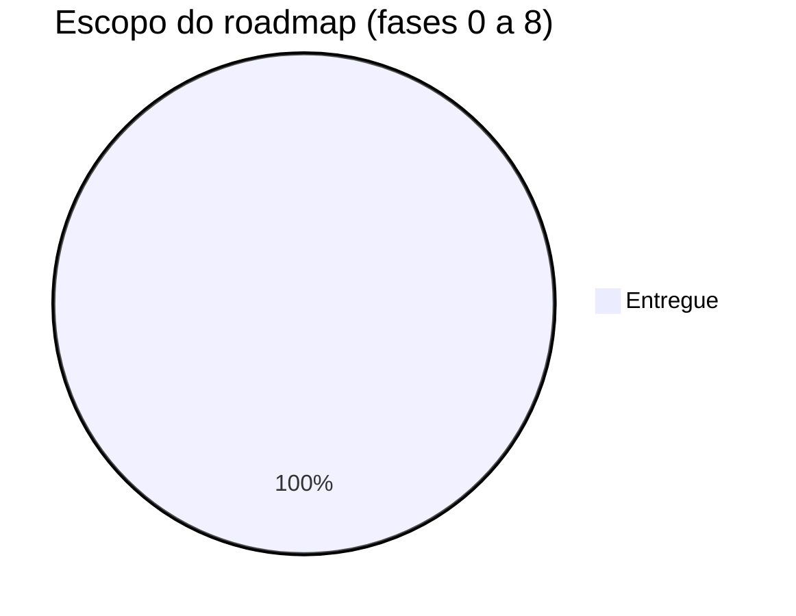
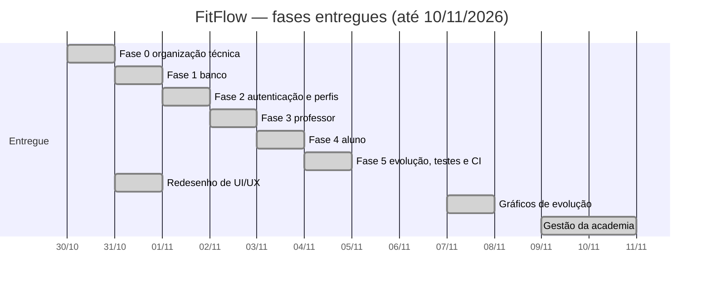

# FitFlow — Home

Sistema de gestão de treinos para academia: **professores** montam fichas e treinos, **alunos** executam e registram a evolução.

> Abra a pasta `docs/` como vault no Obsidian. As notas usam links internos e diagramas Mermaid.

## Mapa do vault

| Nota | Conteúdo |
|---|---|
| [[Architecture]] | Stack real, camadas, papéis e RBAC, rotas por perfil, `e2e/` e CI |
| [[Database]] | Entidades, relacionamentos, ERD, cadeia de 18 migrações |
| [[API]] | As 117 operações HTTP, perfis e permissões |
| [[Roadmap]] | Fases (semanas 1–10) e o que cada fase entregou |
| [[Backlog]] | Ideias deixadas de fora de propósito |
| [[Decisions]] | Registro de decisões arquiteturais (ADR-001 a ADR-038) |
| [[Testing]] | Estratégia e resultados de testes |
| [[Design-System]] | Brief de UI/UX, tokens e API dos componentes do redesenho |
| [[Technical-Debt]] | Dívida técnica aberta e resolvida |
| [[Contrato-Fases-3-5]] | Contrato único usado em paralelo por backend e frontend nas Fases 3–5 |
| [[Contrato-Evolucao]] | Contrato da seção Evolução (gráficos de linha, períodos) |
| [[Contrato-Gestao]] | Contrato da gestão da academia (admin, recepção, professor web) |

## Estado atual (10/11/2026)

**Fases 0 a 5, redesenho de UI/UX, gráficos de evolução e a expansão de gestão da academia (admin, recepção e professor web) estão implementados, revisados e cobertos por testes automatizados.** Papéis `admin`, `recepcao`, `professor` e `aluno`; sessão por cookie `HttpOnly` na web; auditoria; matrículas, pagamentos e controle de entrada; montador de fichas com rascunho e versões (ver [[Architecture]], [[Contrato-Gestao]] e [[Design-System]]). Falta o que depende do ambiente real: aplicar `alembic upgrade head` no banco de produção, rodar o diagnóstico de IDs ([[Database]]), testar em dispositivo físico, executar o CI no GitHub (TD-42) e publicar o branch.

As exceções conscientes (ciclos de periodização, push, refresh token, gateway de pagamento…) estão no [[Backlog]], e a dívida aberta em [[Technical-Debt]].

| Área | Situação |
|---|---|
| Banco + migrações (PostgreSQL/Alembic) | ✅ 18 migrações, head `b7c8d9e0f1a2`; aplicam do zero em Postgres (teste `test_migracoes.py` com `TEST_POSTGRES_URL`) |
| Auth JWT + papéis | ✅ admin, recepção, professor, aluno; cookie `HttpOnly` na web + Bearer no mobile; conta desativada corta o acesso; cadastro de aluno com aprovação. Sem refresh token |
| Exercícios + Cloudinary | ✅ biblioteca da academia e exercícios próprios do professor (`instrucoes`) |
| Fichas → treinos → itens | ✅ vigência, rascunho/publicada, versões, duplicar, `dia_semana` opcional, observação por item, reordenação atômica |
| Professor | ✅ painel, alunos vinculados, sessões, evolução, avaliações (com circunferências), frequência, montador web |
| Aluno: home, ficha, treino do dia, execução | ✅ sessão de treino, série a série, cronômetro de descanso, feedback (esforço 1–10) |
| Histórico, evolução e avaliação física | ✅ gráficos de linha e barras, IMC, CRUD de avaliações (autor edita) |
| Admin | ✅ painel, alunos, professores, recepção (permissões), planos, matrículas, financeiro, configurações, auditoria |
| Recepção | ✅ painel, entrada (liberação manual), cadastro/aprovação, matrículas, pagamentos e comprovante |
| Lembretes | ✅ notificações **locais** (`expo-notifications`); não funcionam na web |
| Perfil (dados, e-mail, senha, foto) | ✅ foto no Cloudinary |
| Testes automatizados | ✅ 539 testes de backend (pytest, +1 pulado sem `TEST_POSTGRES_URL`) · ✅ 890 testes de frontend (jest, 68 suítes) · ✅ 14 cenários E2E (Playwright) · ✅ typecheck · ⚠️ lint com 31 warnings, 0 erros |
| CI (GitHub Actions) | ✅ criado em `.github/workflows/ci.yml`; **ainda não executado no GitHub** |
| App em dispositivo real | ❌ não testado (lembretes não funcionam no Expo Go, TD-57) |

## Gráfico de progresso por fase

## Próximo passo

1. Revisar o branch e **commitar** (o usuário faz os commits).
2. Aplicar `alembic upgrade head` no banco real e rodar o diagnóstico de IDs ([[Database#⚠️ Diagnóstico de dados — bug de IDs (corrigido na Fase 0)]]). A migração `b7c8d9e0f1a2` vincula cada aluno ao professor da ficha ativa mais recente e gera `codigo_acesso`.
3. Configurar produção da web: `CORS_ORIGINS` com a origem do app, `COOKIE_SECURE=true` (e `COOKIE_SAMESITE` conforme o domínio). Criar o admin com `python -m app.scripts.criar_admin`.
4. Testar o app em um aparelho (Expo Go) — lembretes, vibração do cronômetro e câmera/galeria só funcionam lá.
5. Empurrar o branch e conferir o CI; depois atacar a dívida de [[Technical-Debt]].
