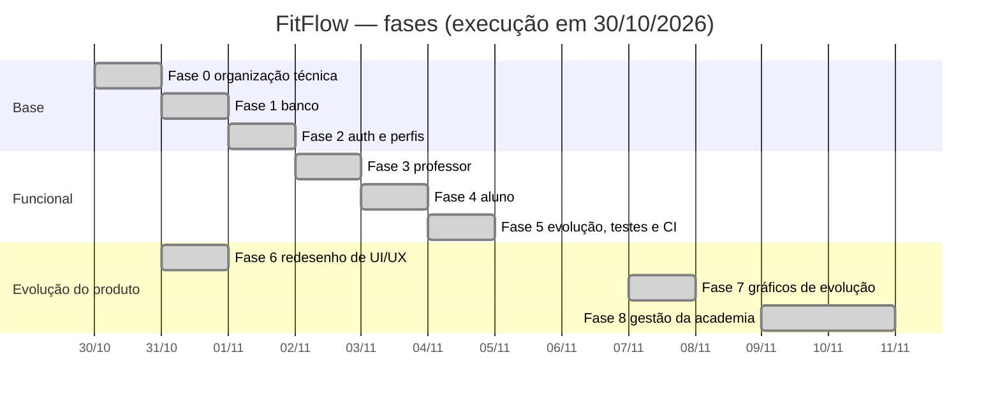

# Roadmap

Voltar: [[Home]] · Ideias soltas: [[Backlog]] · Gestão da academia: [[Contrato-Gestao]]

O plano original de 10 semanas foi **adaptado ao código existente**. As semanas viraram **fases**; a numeração das semanas foi mantida para referência.

| Fase | Foco | Semanas do plano | Situação |
|---|---|---|---|
| 0 | Organização técnica | — | ✅ |
| 1 | Banco | 1 | ✅ |
| 2 | Autenticação, perfis e permissões | 2, 3, 5 | ✅ |
| 3 | **Professor**: fichas com vigência, edição, alunos | 4 (periodização), 6, 7 | ✅ |
| 4 | **Aluno**: home, execução, sessões, cronômetro, feedback | 4 (feedback), 8 | ✅ |
| 5 | **Evolução, avaliação, lembretes, testes e CI** | 9, 10 | ✅ |
| 6 | **Redesenho de UI/UX** (design system, abas por perfil) | — | ✅ |
| 7 | **Evolução**: gráficos de linha, filtros de período | — | ✅ |
| 8 | **Gestão da academia**: admin, recepção, professor web, RBAC, cookie na web, auditoria | — | ✅ (GA-01 a GA-11; fechamento em andamento) |

## Fase 0 — Organização técnica ✅
Dependências completas, entrypoint `app/main.py`, configuração centralizada, correção dos bugs da auditoria (IDs, `treino/hoje`, usuário removido), suíte pytest, documentação do projeto e este vault; mover para `backend/` e `frontend/`. 

## Semana 1 — Banco de dados ✅ (Fase 1)
**Entregue:** 10 tabelas + `sessoes_treino` (11), models SQLAlchemy 2, cadeia de 16 migrações Alembic, migração inicial preenchida (ADR-019), `users.foto_public_id`, fuso `APP_TIMEZONE`, índice único de sessão aberta. `alembic upgrade head` do zero validado em Postgres 16; teste de migrações em `backend/tests/test_migracoes.py` (roda com `TEST_POSTGRES_URL`).

## Semana 2 — Autenticação e perfis ✅ (Fase 2)
**Entregue:** JWT com expiração configurável, perfis aluno/professor/admin, `GET /perfil` com `tipo` e `foto`, CORS por env, admin por comando (`criar_admin`), sessão persistente no app, guarda de rotas por perfil, 401 → login.

## Semana 3 — Exercícios, mídia e fichas ✅ (Fase 2)
**Entregue:** CRUD de exercícios com busca/paginação, upload de imagem e vídeo no Cloudinary, foto de perfil no Cloudinary (ADR-012), login obrigatório em `GET /exercicios` (ADR-013).

## Semana 4 — Periodização, treino do dia, histórico, feedback ✅ (Fases 3 e 4)
**Entregue:** vigência da ficha (`data_inicio`/`data_fim`/`vigente`, ADR-020), `[]` em listas vazias (ADR-014), sessão de treino com esforço percebido e comentário (ADR-021), registro em lote, histórico consultável pelo professor (ADR-022). **Fora de propósito:** ciclos/mesociclos como entidade → [[Backlog]].

## Semana 5 — Fundamentos mobile ✅ (Fase 2)
**Entregue:** Expo Router, camadas tela→hook→service, axios com token, login/cadastro, `AuthContext` com sessão restaurada, tela de perfil.

## Semana 6 — Telas do professor e biblioteca ✅ (Fase 3)
**Entregue:** biblioteca de exercícios, fichas (lista com selo "Vigente", criar com vigência, **editar nome e vigência**), treinos (criar, **editar**, detalhe, excluir).

## Semana 7 — Alunos, vínculo e edição ✅ (Fase 3)
**Entregue:** tela de alunos com busca, detalhe do aluno (fichas, sessões, evolução, avaliações), filtro `GET /ficha?aluno_id=`, editar item inline, reordenar com ↑/↓ via `PUT /treino/{id}/itens/ordem` atômico (ADR-028).

## Semana 8 — Telas do aluno e execução ✅ (Fase 4)
**Entregue:** home do aluno (ficha vigente, treino de hoje, atalhos), ficha completa com mídia, execução série a série gravada na hora (idempotente, ADR-021/029), cronômetro de descanso por timestamp, finalizar com esforço 1–10 e comentário, histórico de sessões.

## Semana 9 — Evolução e avaliação física ✅ (Fase 5)
**Entregue:** evolução por exercício (carga máxima e volume por dia) para aluno e professor, `GraficoEvolucao` sem biblioteca (ADR-023), CRUD de avaliação física com IMC calculado (só o autor edita/exclui), tela de avaliações do aluno com variação de peso.

## Semana 10 — Notificações, polimento, testes e CI ✅ (Fase 5)
**Entregue:** lembrete diário **local** (ADR-024), estados de carregando/erro/vazio (`EstadoTela`), alertas multiplataforma e recarga no foco (ADR-030), testes de frontend com jest-expo (ADR-025), E2E com Playwright (ADR-026), CI no GitHub Actions (ADR-027), lint com ESLint.
**Não feito de propósito:** push notifications, E2E no CI, teste em dispositivo físico → [[Backlog]] e [[Technical-Debt]].

## Fase 6 — Redesenho de UI/UX ✅
**Entregue:** tema escuro preto + amarelo, design system em `components/ui` ([[Design-System]]), abas inferiores por perfil, modal de alerta próprio, prévia do treino, hero com estados, datas `DD/MM/AAAA`, listas virtualizadas, datetimes com offset de `APP_TIMEZONE`.

## Fase 7 — Evolução ✅
**Entregue:** gráficos de linha com `react-native-svg` (ADR-032), filtros de período (`?periodo=`), comparação atual × anterior, reorganização da aba Evolução. Contrato em [[Contrato-Evolucao]].

## Fase 8 — Gestão da academia ✅
**Entregue** ([[Contrato-Gestao]], ADR-033 a ADR-038):
- **Papéis e RBAC**: `admin`, `recepcao`, `professor`, `aluno`; permissões da recepção ajustáveis pelo admin; professor restrito aos alunos vinculados.
- **Web**: sessão por cookie `HttpOnly` com proteção CSRF (`X-FitFlow-Client`); sidebar em telas largas, `TabelaDados`, gráficos de barras.
- **Admin**: painel, alunos, professores, recepção, planos, matrículas, financeiro, configurações da academia e auditoria.
- **Recepção**: painel, controle de entrada (liberado/bloqueado, liberação manual), cadastro e aprovação de alunos, matrículas, pagamentos e comprovante.
- **Professor web**: dashboard, montador de fichas (rascunho, publicar, duplicar, versões), frequência do aluno, avaliações com circunferências.
- **Banco**: migração única `b7c8d9e0f1a2` (ver [[Database]]); auditoria na mesma transação.
**Fora do escopo:** gateway de pagamento, nota fiscal, leitor físico de QR/código de barras, push, multi-academia → [[Backlog]].
